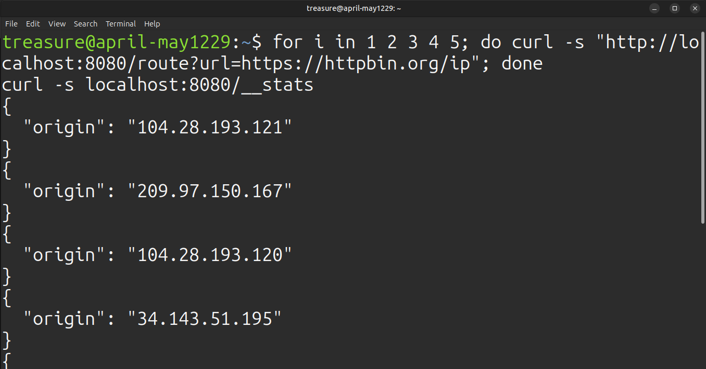
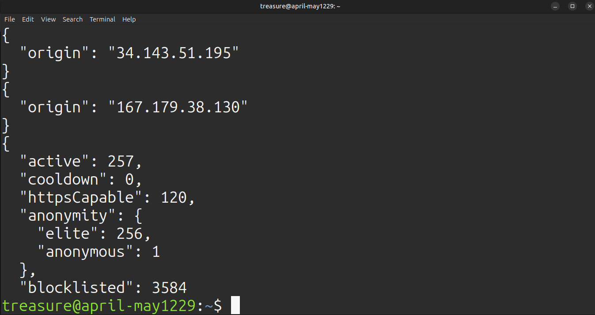
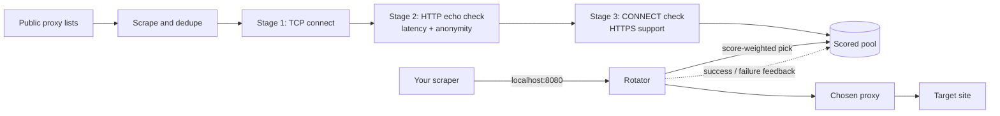

# Smart Proxy Rotator

**A zero-dependency Node.js proxy pool that scrapes free proxies, validates them for speed, anonymity and HTTPS support, and rotates your traffic through the best ones on a single local port.**


Free proxy lists are mostly dead, slow, or leaky. This tool does the tedious part for you: it fetches thousands of candidates, throws out the junk in stages, keeps a scored pool of the survivors, and exposes one stable endpoint (`localhost:8080`). Point your scraper at that port and every request goes out through a different, currently working, anonymous proxy. 
If one dies mid-request, the rotator quietly retries on another, so your scraper never sees the failure.




## Features

- **One local port, two ways to use it.** You can run it as a standard HTTP/HTTPS proxy (`curl -x`), or call `GET /route?url=<target>` from anywhere.
- **Staged validation that scales.** A cheap TCP connect eliminates most dead proxies first, then only the survivors get the expensive checks. Roughly 3,000 candidates are screened in about 20 seconds on a home connection.
- **Real anonymity detection.** Each proxy is tested against an echo endpoint and classified `transparent`, `anonymous` or `elite`. Anything that leaks your real IP is rejected before it enters the pool.
- **HTTPS-aware.** The proxies are tested for `CONNECT` tunnelling, and HTTPS targets are only routed through proxies that passed.
- **Score-based rotation.** Success rate, smoothed latency (EWMA) and freshness are combined into a score. Requests pick randomly among the top proxies, weighted by score, so load is spread without favouring bad ones.
- **Invisible retries.** On a timeout, connection error or proxy-level failure (`407`/`502`), the request is retried on a different proxy, up to a configurable limit.
- **Learns from real traffic.** Every proxied request feeds back into the pool. Proxies that fail on real traffic are demoted immediately, with no extra probing needed.
- **Self-healing pool.** Failing proxies go to a cooldown, then get a second chance, then are blocklisted. The pool refills itself automatically when it runs low.
- **Instant restarts.** The pool is saved to disk periodically and on exit, then restored and re-checked on the next start.
- **Zero dependencies.** It's built only on Node's standard library (`http`, `net`, `tls`, `https`, `fs`).

## How it works



Validation runs in the background while the server is already accepting requests. Request handling never waits on validation: it just samples from a pre-sorted, in-memory snapshot of the active pool.

## Quick start

Requires **Node.js 18 or newer** (uses the built-in `fetch`).

```bash
git clone https://github.com/treasure-cd/proxy-rotator.git
cd proxy-rotator
node src/index.js
```

There's pretty much nothing to install. On first run the pool is empty, so give it a minute or two to scrape and validate. Watch progress with:

```bash
curl http://localhost:8080/__stats
```

When `active` and `httpsCapable` are above zero, you're ready. Later starts are near-instant since the previous pool is restored from disk.

## Usage

### As a standard proxy

```bash
curl -x http://localhost:8080 http://httpbin.org/ip
curl -x http://localhost:8080 https://httpbin.org/ip
```

Run it a few times and the `origin` IP changes while never showing your own.

**Python (`requests`)**
```python
import requests

proxies = {"http": "http://localhost:8080", "https": "http://localhost:8080"}
r = requests.get("https://httpbin.org/ip", proxies=proxies, timeout=30)
print(r.json())
```

### Via the `/route` endpoint

Useful when your HTTP client doesn't make proxy configuration easy. Pass the target as the `url` parameter, which must come first:

```bash
curl "http://localhost:8080/route?url=https://httpbin.org/ip"
```

Both raw and URL-encoded targets work, and the target's own query string is preserved:

```bash
curl "http://localhost:8080/route?url=https://example.com/search?q=shoes&page=2"
```

**Node.js**
```js
const target = 'https://httpbin.org/ip';
const res = await fetch(`http://localhost:8080/route?url=${encodeURIComponent(target)}`);
console.log(res.headers.get('x-proxy-used'), await res.json());
```

Every forwarded response carries an `x-proxy-used` header naming the proxy that served it, which is handy for debugging.

### Admin endpoints

| Endpoint | Returns |
|---|---|
| `GET /__stats` | Pool counts: active, cooldown, HTTPS-capable, anonymity breakdown, blocklisted |
| `GET /__pool` | The top 50 active proxies with score, latency, anonymity, HTTPS support, and success/fail counts |

Example `/__stats` from a real run:

```json
{
  "active": 233,
  "cooldown": 19,
  "httpsCapable": 147,
  "anonymity": { "elite": 233 },
  "blocklisted": 2626
}
```

In that run, 2,911 scraped candidates narrowed to 1,209 that accepted a TCP connection, and then to 233 that passed every check. Free proxies are volatile, so expect your numbers to differ.

## How proxies are judged

**Validation stages**

1. **TCP connect** (3 s timeout): does the port even open? This alone discards the majority of the list.
2. **HTTP echo check** (8 s timeout): a real request through the proxy to an echo endpoint. Measures latency and classifies anonymity.
3. **CONNECT check**: can the proxy open an HTTPS tunnel? Determines whether it can serve `https://` targets.

**Anonymity levels**

| Level | Meaning | Accepted by default |
|---|---|---|
| `transparent` | Your real IP appears in the origin or forwarded headers | No |
| `anonymous` | IP hidden, but proxy-revealing headers (`Via`, `Forwarded`, `X-Forwarded-For`, ...) are present | Yes |
| `elite` | IP hidden and no proxy-revealing headers | Yes |

**Scoring**

```
score = successRate × 1 / (1 + latencyEWMA / 1000) × freshness
```

- `successRate` is smoothed, `(ok + 1) / (ok + fail + 2)`, so a brand-new proxy isn't treated as perfect or hopeless.
- `latencyEWMA` is an exponentially weighted moving average, so one lucky or unlucky sample doesn't swing the ranking.
- `freshness` decays toward a floor of 0.3 as the last check gets older, which pushes stale proxies down until they're re-verified.

**Lifecycle**

```
candidate → active → cooldown → dead (blocklisted for 30 min)
                ↑________|  (recovers on a successful re-check)
```

Three consecutive failures send an active proxy to cooldown. A proxy that fails again after its cooldown is evicted and blocklisted, so rescraping the same lists doesn't re-add it.

## Configuration

Everything lives in [`src/config.js`](src/config.js). `HOST`, `PORT` and `STATE_FILE` can also be set through environment variables.

| Setting | Default | Description |
|---|---|---|
| `HOST` | `127.0.0.1` | Interface to bind. Keep this on localhost unless you add authentication |
| `PORT` | `8080` | Local port |
| `SOURCES` | 3 public lists | URLs of `ip:port` lists to scrape |
| `ALLOWED_ANON` | `anonymous`, `elite` | Anonymity levels allowed into the pool |
| `TCP_TIMEOUT` / `HTTP_TIMEOUT` | `3000` / `8000` ms | Validation timeouts |
| `TCP_CONCURRENCY` / `HTTP_CONCURRENCY` | `300` / `100` | Concurrent validation checks |
| `MIN_ACTIVE` | `30` | Trigger a fresh scrape when the pool drops below this |
| `REFRESH_MS` | 10 min | How often to scrape and validate new candidates |
| `REVALIDATE_MS` | 3 min | Re-check active proxies older than this |
| `MAX_FAILS` | `3` | Consecutive failures before cooldown |
| `TOP_N` | `20` | Pick among the best N proxies (smaller = faster, larger = more IP diversity) |
| `MAX_RETRIES` | `3` | Different proxies tried per request |
| `REQUEST_TIMEOUT` | `15000` ms | Per-attempt timeout when forwarding |
| `STATE_FILE` | `pool-state.json` | Where the pool is persisted between runs |

## Project layout

```text
src/
├── index.js       # startup, refresh / revalidate loop, persistence
├── server.js      # HTTP forwarding, CONNECT tunnelling, /route, admin API
├── pool.js        # proxy records, scoring, lifecycle, weighted selection, save/load
├── validator.js   # TCP / HTTP / CONNECT checks, anonymity classifier, concurrency helper
├── sources.js     # fetch, parse and dedupe public lists
└── config.js      # all tunables

test/
├── helpers.js          # mock proxies, mock targets, and a ready-made test rig
├── pool.test.js        # scoring, selection, lifecycle, persistence
├── validator.test.js   # anonymity classifier, TCP/HTTP/CONNECT checks, concurrency helper
├── sources.test.js     # proxy-list parsing
├── server.test.js      # end-to-end: proxy mode, failover, CONNECT, /route, admin API
└── route-https.test.js # /route with HTTPS targets (needs openssl; skips otherwise)
```

```markdown
## Testing

```bash
npm test

## Limitations and responsible use

Being upfront about what this is and isn't:

- **Free proxies are untrusted.** Whoever runs one can see and alter plain HTTP traffic. For HTTPS, the tunnel keeps contents encrypted, but never send credentials, tokens or anything sensitive through a free proxy.
- **"Anonymous" means hidden from the target, not from the proxy operator.**
- **Many sites block known proxy and datacenter ranges.** A proxy that passes validation can still be refused by your specific target. A `403` or `429` from the target is *not* counted as a proxy failure, since it usually means the site rejected you rather than the proxy breaking.
- **HTTP proxies only for now.** SOCKS4/5 sources are not yet supported, and parsing is IPv4 only.
- **Validation depends on an echo endpoint** (`httpbin.org` by default). If it's slow or unreachable from your network, set `ECHO_URL` and `IP_URL` in the config to another one.
- **Request bodies are buffered in memory** so failed requests can be retried, so this isn't built for huge uploads.
- **No authentication on the local port.** It binds to `127.0.0.1` by default for that reason. If you expose it, put authentication in front.

Use this for legitimate purposes and respect the terms of service and `robots.txt` of the sites you access.

```markdown
## Roadmap

- [ ] CLI interface for global installation, terminal commands, and live proxy monitoring
- [ ] SOCKS4/SOCKS5 support
- [ ] Per-host cooldowns (don't reuse a proxy on the same site within N seconds)
- [ ] Sticky sessions for multi-step flows (logins, carts)
- [ ] Detect proxies blocked by a specific target and route around them
- [ ] Geo and ASN filtering
- [ ] Configurable sources and echo endpoints via environment variables
- [x] Automated test suite

## Contributing

Issues and pull requests are welcome. If you're adding a new proxy source, please make sure it's a plain-text `ip:port` list, since the parser is deliberately strict. For larger changes, open an issue first so we can talk through the approach.

## License

[MIT](LICENSE)
